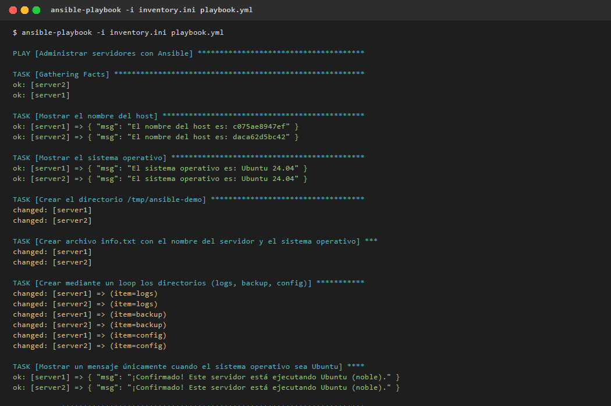

# Laboratorio de Ansible con Servidores Docker

## Objetivo de la práctica
El objetivo de este laboratorio es implementar y gestionar dos servidores Linux (Ubuntu 24.04) en contenedores Docker y administrarlos de manera automatizada utilizando **Ansible** mediante el conector nativo de Docker (`ansible_connection=docker`).

---

## Estructura del Proyecto
```text
ansible-lab/
├── docker-compose.yml
├── inventory.ini
├── playbook.yml
└── README.md
```

---

## Requisitos Previos
- Docker Desktop instalado y en ejecución.
- Python 3 y Ansible instalados en la máquina anfitriona (o WSL / contenedor controlador).

---

## Paso 1: Iniciar los contenedores Docker
Desde la carpeta `ansible-lab`, ejecuta:

```bash
docker compose up -d
```

Verifica que ambos contenedores estén ejecutándose:
```bash
docker ps
```

---

## Paso 2: Preparar los contenedores (Instalación de Python)
Ansible requiere Python en los nodos administrados para ejecutar sus módulos. Instálalo en cada contenedor:

```bash
# En server1
docker exec -it server1 bash -c "apt update && apt install -y python3"

# En server2
docker exec -it server2 bash -c "apt update && apt install -y python3"
```

---

## Paso 3: Probar la conectividad con Ansible
Verifica la comunicación con el módulo ping:

```bash
ansible docker -i inventory.ini -m ping
```

---

## Paso 4: Ejecutar el Playbook
Ejecuta las tareas automatizadas con:

```bash
ansible-playbook -i inventory.ini playbook.yml
```

### Tareas que realiza el Playbook:
1. Muestra el nombre de host (`ansible_hostname`).
2. Muestra el sistema operativo y su versión (`ansible_distribution`).
3. Crea el directorio `/tmp/ansible-demo`.
4. Crea el archivo `/tmp/ansible-demo/info.txt` con el nombre del servidor y sistema operativo.
5. Crea mediante un bucle (`loop`) las carpetas `logs`, `backup` y `config`.
6. Muestra un mensaje condicional solo si el SO es Ubuntu.

---

## Captura de Pantalla
A continuación se muestra la evidencia de la ejecución exitosa del playbook:


